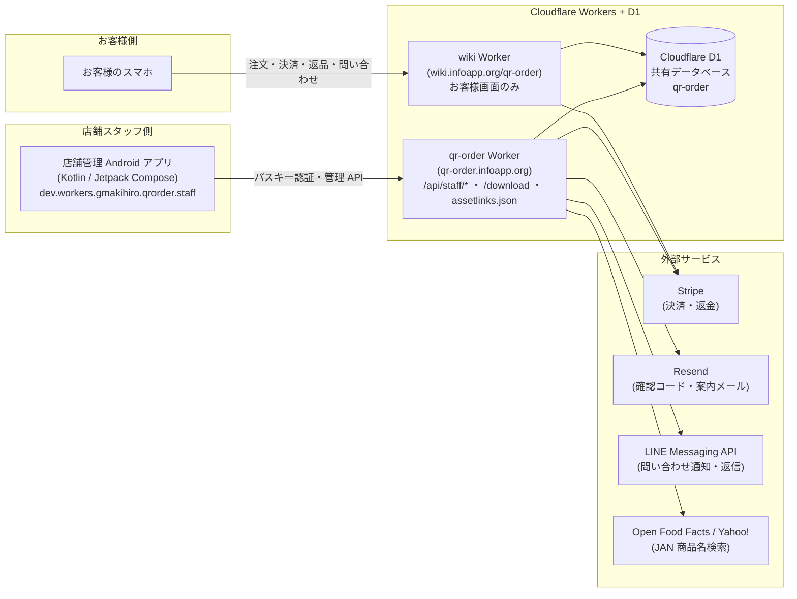

# QR オーダー 店舗管理 Android アプリ — 資料作成用リファレンス（引き継ぎサマリー）

> [!NOTE]
> このドキュメントは、別のセッションで各種資料（システム構成書・アプリ仕様書・操作マニュアル・プレゼン資料・開発レポート等）を作成するための基礎資料です。機密情報（API キー・署名鍵・個人メールアドレス）は含まれていません。

---

## 1. プロジェクト概要・背景

店頭 QR 注文・事前決済システム「**QR オーダー**」において、従来は Web アプリ内で提供していた店舗スタッフ向けの管理画面（`/staff`）を廃止し、**Kotlin + Jetpack Compose によるネイティブ Android 店舗管理アプリ**として新規開発した。

これに合わせてシステム全体をお客様向けと店舗管理向けで明確に役割分離した。

| 役割 | リポジトリ | 公開 URL | 主な内容 |
| :--- | :--- | :--- | :--- |
| **お客様向け** | [`kakusan0/wiki`](https://github.com/kakusan0/wiki)（`apps/qr-order/`） | `https://wiki.infoapp.org/qr-order/` | 公式サイト、注文・カート・Stripe 決済画面（`/s/:storeId`）、購入証明、返品・交換申請、問い合わせチャット、電子棚札（`/esl/`, `/p/`）、お客様用ガイド、お客様用 Android TWA |
| **店舗管理向け** | [`kakusan0/qr-order`](https://github.com/kakusan0/qr-order) | `https://qr-order.infoapp.org/` | ネイティブ Android 店舗管理アプリ（`android/`）、店舗管理 API（`/api/staff/*`）、Digital Asset Links（`/.well-known/assetlinks.json`）、APK 配布サイト（`/download`） |

---

## 2. システム全体構成図

---

## 3. Android アプリ基本仕様

| 項目 | 値 |
| :--- | :--- |
| アプリ名 | 店舗管理 |
| パッケージ名 (`applicationId`) | `dev.workers.gmakihiro.qrorder.staff` |
| バージョン | `v1.0.3` (`versionCode = 4`) |
| 対応 Android | Android 8.0 以上 (`minSdk = 26`, `compileSdk = 37`, `targetSdk = 37`) |
| UI フレームワーク | Jetpack Compose + Material 3（ライト／ダークテーマ対応・ブランドカラー深緑 `#0A6B50`） |
| ビルドツール | Gradle 9.6.0 / Android Gradle Plugin (AGP) 9.5.3 / Kotlin 2.4.21 |
| デフォルト接続先 | `https://qr-order.infoapp.org`（旧 `workers.dev` URL 保存端末は自動移行） |
| 認証方式 | パスキー専用（Android Credential Manager + FIDO2/WebAuthn、初回はメール 6 桁確認コード） |
| 配布方式 | 専用配布ページ（`https://qr-order.infoapp.org/download`）よりリリース署名済み APK（約 12.2 MB）を配信 |
| アプリアイコン | 店舗のオーニング屋根＋QR コード（深緑グラデーション背景＋白・ミントアクセント、Android 13+ モノクロテーマアイコン対応） |

### 主要ライブラリ

- **UI / アーキテクチャ**: Jetpack Compose BOM `2026.02.00`, Material 3, Material Icons Extended, Lifecycle ViewModel Compose, Coroutines
- **通信・認証**: OkHttp `5.5.1`（CookieJar で `staff_session` を永続管理）, AndroidX Credentials `1.5.0`（Credential Manager / Play Services Auth）
- **バーコード・QR**: CameraX `1.7.0` + Google ML Kit Barcode Scanning `17.3.0`（JAN-13/8 読み取り）, ZXing Core `3.5.4`（店舗 QR・商品 QR のオンデバイス生成）

---

## 4. 画面・機能一覧

### 4.1 認証・初期設定
- **ログイン画面**（[LoginSetupScreen.kt](../android/app/src/main/java/com/example/myapplication/ui/screens/LoginSetupScreen.kt)）
  - パスキーでワンタップログイン（Android Credential Manager で生体認証・画面ロック確認）
  - 初回セットアップ（メールアドレス入力 → 6 桁確認コード送信 → コード検証 → パスキー登録）
  - 接続先サーバー設定・オフライン動作確認用のモックモード切替（[WebLoginDialog.kt](../android/app/src/main/java/com/example/myapplication/ui/components/WebLoginDialog.kt)）

### 4.2 メイン画面（7 タブ構成・権限別表示）
[StaffAppRoot.kt](../android/app/src/main/java/com/example/myapplication/ui/screens/StaffAppRoot.kt) を起点に、店舗切替・ロール別（`admin` / `staff`）制御・テーマ切替・ログアウトを備える。

| タブ | 画面ファイル | 主な機能 | 権限 |
| :--- | :--- | :--- | :--- |
| **注文** | [OrdersTab.kt](../android/app/src/main/java/com/example/myapplication/ui/screens/OrdersTab.kt) | 注文一覧表示（すべて／年齢確認待ち／返金済）、商品明細・店舗からの GPS 距離表示、年齢確認完了操作、全額／一部返金（テンキー入力 [NumpadDialog.kt](../android/app/src/main/java/com/example/myapplication/ui/components/NumpadDialog.kt)） | 閲覧・年齢確認：全員 / 返金：管理者のみ |
| **商品** | [ProductsTab.kt](../android/app/src/main/java/com/example/myapplication/ui/screens/ProductsTab.kt) | 商品一覧、新規登録・編集・削除、販売中／停止の切替、CameraX + ML Kit による JAN バーコードスキャン（[BarcodeScannerDialog.kt](../android/app/src/main/java/com/example/myapplication/ui/components/BarcodeScannerDialog.kt)）と商品名自動検索、商品 QR 表示 | 切替：全員 / 登録・編集・削除：管理者のみ |
| **返品** | [ReturnsTab.kt](../android/app/src/main/java/com/example/myapplication/ui/screens/ReturnsTab.kt) | 返品・交換申請一覧、添付写真の拡大プレビュー、承認（返金／交換）・却下（理由メッセージ必須）・商品回収完了（自動返金連携） | 閲覧：全員 / 承認・却下・完了：管理者のみ |
| **問い合わせ** | [ChatTab.kt](../android/app/src/main/java/com/example/myapplication/ui/screens/ChatTab.kt) | 注文ごとのチャットスレッド一覧・メッセージ閲覧・返信、LINE 公式アカウント連携コード発行・解除 | チャット：全員 / LINE 連携：管理者のみ |
| **店舗 QR** | [StoreQrTab.kt](../android/app/src/main/java/com/example/myapplication/ui/screens/StoreQrTab.kt) | 店頭用 QR コード生成（[QrCodeImage.kt](../android/app/src/main/java/com/example/myapplication/ui/components/QrCodeImage.kt)）、入口タブレット向け全画面表示モード（[DisplayQrScreen.kt](../android/app/src/main/java/com/example/myapplication/ui/screens/DisplayQrScreen.kt)）、QR 定期更新間隔設定、店舗 GPS 位置・ジオフェンス範囲（50m〜1000m）・地図短縮リンク展開 | 閲覧・表示：全員 / 設定変更：管理者のみ |
| **スタッフ** | [StaffAccountsTab.kt](../android/app/src/main/java/com/example/myapplication/ui/screens/StaffAccountsTab.kt) | スタッフアカウント一覧、新規招待（メール案内）、有効／無効切替、パスキー再セットアップ許可（機種変更・紛失時）、削除 | 管理者のみ |
| **パスキー** | [PasskeysTab.kt](../android/app/src/main/java/com/example/myapplication/ui/screens/PasskeysTab.kt) | 自分の登録済みパスキー一覧、新しい端末・認証器のパスキー追加、不要なパスキーの削除 | 全員（自分のパスキー） |

---

## 5. アプリ内部アーキテクチャ

MVVM + Repository パターンで構成し、実サーバー接続とモック動作をインターフェースで切り替えられる設計。

- **UI 層**: Jetpack Compose 画面群 + [StaffViewModel.kt](../android/app/src/main/java/com/example/myapplication/ui/StaffViewModel.kt)（`StateFlow` による単方向データフロー）
- **Repository 層**:
  - [StaffRepository.kt](../android/app/src/main/java/com/example/myapplication/data/repository/StaffRepository.kt)（インターフェース＋API エンドポイント定数）
  - [RemoteStaffRepository.kt](../android/app/src/main/java/com/example/myapplication/data/repository/RemoteStaffRepository.kt)（本番 API 連携実装）
  - [MockStaffRepository.kt](../android/app/src/main/java/com/example/myapplication/data/repository/MockStaffRepository.kt)（オフライン検証用モック実装）
- **通信・認証層**:
  - [QrOrderApiClient.kt](../android/app/src/main/java/com/example/myapplication/data/remote/QrOrderApiClient.kt)（OkHttp ベース REST クライアント＋写真バイナリ取得）
  - [PasskeyManager.kt](../android/app/src/main/java/com/example/myapplication/data/remote/PasskeyManager.kt)（Credential Manager によるパスキー作成・認証）
  - [ApiConfigStore.kt](../android/app/src/main/java/com/example/myapplication/data/remote/ApiConfigStore.kt)（接続先 URL・モック切替・`staff_session` Cookie 管理・旧ドメイン自動移行）

---

## 6. セキュリティ・認証・ビルド最適化のポイント

1. **Android ネイティブパスキー連携（Digital Asset Links + WebAuthn Origin 検証）**
   - サーバーの `/.well-known/assetlinks.json` で `delegate_permission/common.get_login_creds` を返却し、アプリの署名証明書 SHA-256 とパッケージ名を紐づけ。
   - サーバー側 WebAuthn 検証（`@simplewebauthn/server`）の `expectedOrigin` で通常の HTTPS Origin に加え `android:apk-key-hash:<base64url>` を許可。
2. **リリースビルド署名・最適化**
   - 専用のリリース署名鍵（V1 + V2 + V3 署名）を設定し、`keystore/` と `keystore.properties` は `.gitignore` で厳密に除外。
   - R8 コード最適化・リソース縮小・ABI 絞り込み（`arm64-v8a`, `armeabi-v7a`）で APK サイズを約 12.2 MB に軽量化。
   - ML Kit の `ComponentRegistrar` が R8 により削除されないよう [proguard-rules.pro](../android/app/proguard-rules.pro) に keep ルールを定義し、実機（Pixel 9 Pro XL）ログで警告ゼロを確認。
3. **Web 店舗管理画面の完全廃止と配布導線**
   - `kakusan0/wiki` および `kakusan0/qr-order` の両方から Web 版店舗管理画面（`/staff*`）を削除。
   - `https://qr-order.infoapp.org/` にアクセスすると自動で `/download`（APK 配布ページ＋QR コード＋インストール手順・Google Play プロテクト案内）へリダイレクト。
4. **CI/CD（GitHub Actions）**
   - `kakusan0/qr-order`: サーバー型チェック・脆弱性チェック・API テスト（`ci.yml`）、Android 単体テスト＋APK ビルド（`android.yml`）、CodeQL セキュリティスキャンが自動実行・全通過。
   - `kakusan0/wiki`: 全作品の型チェック・テスト・ビルド（`check.yml`）、お客様用 Android ビルド（`qr-order-android.yml`）が全通過。

---

## 7. 開発〜リリースの主なマイルストーン（PR・履歴）

1. ネイティブ Android 店舗管理アプリの実装（全 7 タブ、CameraX + ML Kit バーコードスキャン、ZXing QR 生成、Credential Manager パスキー認証、単体テスト 6 件）
2. Cloudflare Workers サーバーへの Android パスキー対応追加・リリース署名鍵生成・APK 配布サイト（`/download`）構築
3. 実機（Pixel 9 Pro XL）インストール検証・R8 最適化時の ML Kit `ComponentRegistrar` 対策（`proguard-rules.pro`）
4. リポジトリ役割分離：
   - `kakusan0/wiki` [PR #11](https://github.com/kakusan0/wiki/pull/11)（マージ済）：Web 店舗管理画面および `staff` フレーバーを削除しお客様画面のみに変更
   - `kakusan0/qr-order` [PR #3](https://github.com/kakusan0/qr-order/pull/3)（マージ済）：お客様画面・Web 管理画面を削除し、ネイティブ Android 店舗管理アプリ＋管理 API サーバー専用化
5. 独自ドメイン移行・アプリアイコン刷新：
   - `kakusan0/qr-order` [PR #4](https://github.com/kakusan0/qr-order/pull/4)（マージ済）：`v1.0.3` として接続先を `https://qr-order.infoapp.org` へ変更・店舗＋QR の新アプリアイコンへ刷新・Cloudflare Workers デプロイ＆実機反映完了

---

## 8. 作成可能な資料のアイデア（別セッション用プロンプト例）

別セッションで以下のファイルパスを指定して依頼するとスムーズに作成できます。

- **技術仕様書・設計書を作る場合**:
  > `docs/android-staff-app-reference.md` をもとに、開発者向けの「QR オーダー 店舗管理 Android アプリ 技術仕様書」を作成してください（システム構成図・認証シーケンス図・API 一覧・画面遷移を含む）。
- **店舗スタッフ向け操作マニュアルを作る場合**:
  > `docs/android-staff-app-reference.md` をもとに、店舗スタッフ向けの「店舗管理アプリ 導入・操作マニュアル」をわかりやすい日本語で作成してください（APK インストール・初回パスキー設定・注文確認・返金・商品登録・返品対応の手順）。
- **プレゼン・紹介スライド構成を作る場合**:
  > `docs/android-staff-app-reference.md` をもとに、Web 管理画面からネイティブ Android アプリへ移行した背景・アーキテクチャ・セキュリティ設計・成果をまとめた 10 枚程度のスライド構成案を作成してください。
